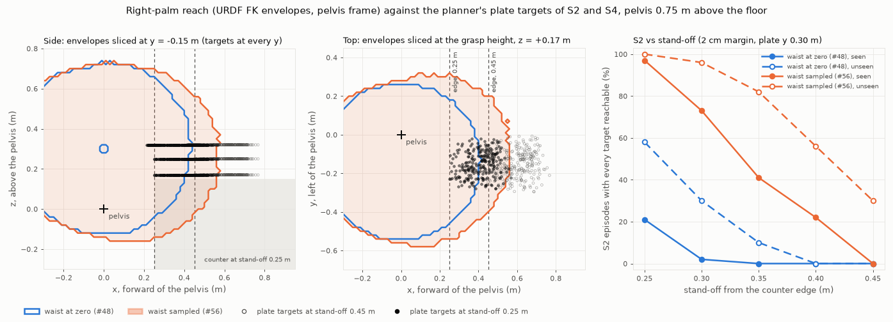

# Reach-gap analysis: stand-off, plate box and waist range (#56)

Measured 2026-10-23 with numpy only, no simulation: URDF forward kinematics
(`robots/kinematics.py`, Unitree `g1_29dof_with_hand_rev_1_0.urdf` at commit `073aec51`), the
seeded episode sampler (`scene/randomization.py`) and the planner's waypoint geometry
(`planning/plate_to_rack.py`). It gives #10, #14 and #16 a starting point for the open design
question in docs/status.md. Isaac Sim still has to confirm the URDF chain against the USD (#3), and
the envelopes against the real IK (#16). **Every slot number is provisional**: the dishwasher's
kitchen pose is not a constant yet (#59 adds it), so it comes from a flag whose default is derived
below.

Reproduce: `py -3.12 scripts/reach_gap_analysis.py --figure docs/figures/reach_gap.png` (about
two minutes). The CSV files and `tables.md` go to `outputs/reach_gap/` (git-ignored).

## Short answer

| Knob | Today | Recommended | What it buys (S2 seen / unseen, 2 cm margin) |
| --- | --- | --- | --- |
| `ROBOT_STANDOFF_M` | 0.45 m | **0.25 m** | 0 / 0 → 21 / 58 with the waist at zero |
| Waist (planner-commanded lean) | held at 0 | **pitch +29.8 deg (the 0.52 rad URDF limit) for pre-grasp, grasp and lift; upright from the counter edge on; yaw and roll 0** | with the 0.25 m stand-off: 97 / 100 |
| `PLATE_NOMINAL_XY_M` y | 0.30 m | **0.30 m, unchanged** | moving it 5 cm closer buys what 5 cm of stand-off buys, but pushes 24 % of the unseen 27 cm plates past the counter edge |
| Rack pose (provisional) | floor-standing `dishwasher_2`, right of the plate box | **not reachable from any stance tested**; slots need the rack base at 0.5 to 0.7 m and within 0.25 m to the right of the pelvis | S3 0 / 0 at the derived pose for every stand-off and both envelopes |

Before and after (2 cm margin, `waist0` = the #48 envelope at the current constants, `waist` =
the #56 envelope at the recommended 0.25 m stand-off):

| Episode | Seen before → after | Unseen before → after |
| --- | --- | --- |
| S1 (pre_grasp, grasp) | 0 → 96 % | 0 → 100 % |
| S2 (pre_grasp, grasp, lift) | 0 → 97 % | 0 → 100 % |
| S4, plate half (adds counter_edge) | 0 → 92 % | 0 → 100 % |
| S4, all seven targets (provisional rack) | 0 → 0 % | 0 → 0 % |

Without the margin (`contains`): S1 0 → 100 / 0 → 100, S2 0 → 100 / 0 → 100, S4 plate half
0 → 98 / 0 → 100. Neither knob alone is enough: the 0.25 m stand-off with the waist at zero gives
S2 21 / 58, the waist envelope at today's 0.45 m gives S2 0 / 30.

If #14 puts the IK's `body_offset` at the finger bases (7.8 cm along the palm link, where the rim
sits in a Dex3 grasp), 0.30 m with the same lean reaches S2 98 / 100 and leaves 5 cm more room to
the counter; see the sensitivity table. Change no constant before #14 has fixed the controlled
point: the stand-off recommendation depends on it.

## Method

### Envelopes

| File | Waist | Samples, seed | Voxels (2 cm) | Bounding box min to max, pelvis frame (m) | Size |
| --- | --- | --- | --- | --- | --- |
| `right_arm_envelope.npz` (#48) | yaw, roll, pitch at 0 | 2,000,000, 48 | 41,270 (0.330 m³) | (-0.44, -0.56, -0.14) to (0.44, 0.28, 0.74) | 4,062 B |
| `right_arm_envelope_waist.npz` (#56) | yaw -20 to +20 deg, roll 0, pitch 0 to +29.79 deg | 8,000,000, 48 | 55,034 (0.440 m³) | (-0.48, -0.60, -0.16) to (0.58, 0.34, 0.74) | 5,496 B |

Both sample the origin of `right_hand_palm_link` in the pelvis frame, the seven right-arm joints
uniform in the URDF limits with the 5 degree wrist margin of architecture section 7. The waist file
also draws the three waist joints, each uniform in its range, from a second generator
(`default_rng([seed, 56])`), so its arm draws are the #48 draws. The URDF waist limits are yaw
±2.618 rad (±150 deg), roll and pitch ±0.52 rad (±29.79 deg); the requested pitch of +30 deg is
clipped to +29.79. Why this range: forward lean is the waist motion that brings the palm toward the
counter (positive pitch tips the torso forward; at +0.3 rad the right shoulder moves 7.3 cm
forward); ±20 deg of yaw turns the right shoulder toward the plate box and the rack without the
URDF's ±150 deg, which would swing the arm behind the robot; roll stays 0 because a side lean
moves the shoulder a few centimetres sideways and costs balance. The waist envelope holds 99.81 %
of the #48 voxels (41,191 of 41,270); the 79 missing ones are on the sparse boundary. It reaches
14 cm further forward: at the grasp height (+0.17 m above the pelvis) and 2 cm inside the
boundary, the palm reaches 0.36 to 0.38 m forward with the waist at zero and 0.50 to 0.53 m with
the waist sampled, for pelvis-frame `y` from -0.05 to -0.25 m.

### Targets

For each of the ten (scenario, split) pairs every committed seed is drawn with `sample_split`
(seen: 100 seeds, 50 for S4; unseen: 50), 700 episodes in all. Each episode's planner inputs are
built in the kitchen frame (origin on the floor at the middle of the counter's front edge, `x`
along the counter and to the robot's right, `y` into the counter, `z` up), passed through
`plan_waypoints` with the default `PlannerConfig` and expressed in the episode's pelvis frame:

- **Pelvis.** At `(dx, -standoff + dy, h)` with yaw `90 deg + dyaw`, facing `+y`, where `dx`,
  `dy` (±2 cm) and `dyaw` (±5 deg) are the spec's pelvis noise. `h` = **0.75 m**, flag
  `--pelvis-height`: `G1_29DOF_CFG.init_state.pos` z in Isaac Lab v3.0.0 `unitree.py:437`, which
  `robots/g1_dex3.py` (#46) inherits, and the stand env's height target. The settled standing
  height is #5's to measure; ±3 cm changes S2 by at most 8 points (sensitivity table).
- **Grasp point** (`plate_pose`, the grasp frame on the rim). The rim point nearest the robot,
  `(x, y - D/2)` of the drawn plate centre and diameter `D`, at the rim top, 0.92 m (counter
  0.90 m plus the 20 mm plate height), with the drawn plate yaw. #52's "0.61 to 0.84 m ahead" was
  the plate centre; the near rim is 11 to 13.5 cm closer. At today's 0.45 m stand-off the grasp
  points lie 0.52 to 0.77 m (seen) and 0.45 to 0.68 m (unseen) ahead of the pelvis, 0.00 to
  0.32 m to its right, 0.17 m above it. `--grasp-point centre` gives the centre (sensitivity
  table: the gap reopens).
- **Which point the targets refer to.** The planner's palm target is the grasp frame itself
  (`palm_pose` coincides with it at the grasp); the envelopes are of the `right_hand_palm_link`
  origin, and `ArmTargetPipeline` compares the two directly, so the tables read the targets as
  palm-link targets. #14's IK `body_offset` moves the controlled point; the finger-base row of the
  sensitivity table re-samples both envelopes (same seeds and counts) for the point
  `(0.0777, -0.0016, 0)` m in the palm link frame, the mean of the index and middle finger base
  joint origins. The offset matters: it is worth about one 5 cm step of stand-off.
- **Counter edge** (`counter_edge_pose`). The counter's front edge (`y = 0`, 0.90 m) at the grasp
  point's `x`. With the 15 cm clearance the waypoint is at the lift height, 1.07 m, 0.32 m above
  the pelvis, `standoff` ahead of it.
- **Slot** (`slot_pose`, the grasp frame at the slot entry). The drawn slot (rack frame,
  `RackSlotLayout.slot_pose`) placed by `--rack-pose x y z yaw_deg`, raised by `D`: the palm holds
  the top of the vertical plate whose lower edge is at the top of the tines. The default,
  **(0.55, 0.00, 0.09, 0 deg), provisional**, is derived from architecture section 10 and its
  sources: ArtVIP `dishwasher_2` (D011), a free-standing unit, on the floor under the counter on the
  right, where `kitchen_dims` keeps room for it (the plate box ends at `x = 0.25` m, the counter at
  0.90 m; the 0.48 m wide unit centred at 0.55 m); its front flush with the counter's front edge,
  door open; the lower rack, centred about 0.20 m behind the front of the 0.395 m deep body, pulled
  out by its full 0.2 m travel (D011) to `y = 0`; its base at the inspected `z = 0.088` m (#29,
  scale 1.0); the rack's `x` (across the tines) along the counter, so yaw 0. The slot targets then
  lie 0.40 to 0.70 m to the right of the pelvis, `above_slot` 0.05 to 0.10 m below it and
  `insertion` 0.35 to 0.40 m below it.

`aligned` has the position of `above_slot` (only its orientation differs), so its column repeats
it. Target sets: S1 has no reach-target distribution of its own yet (docs/evaluation.md: "a reach
target appears in the front workspace"), so its stand-in is its plate draw's `pre_grasp` and
`grasp`; S2 is `pre_grasp`, `grasp`, `lift`; S3 (plate already in hand) is the three slot
targets; S4 is all seven, and its plate half is the first four. An episode is reachable if every
target of its set is. A target counts if `contains` is true, and "with margin" if
`margin_contains(p, 0.02)` is, which keeps it off the sparse sampled boundary.

Sweeps: stand-off 0.25 to 0.45 m and the plate box centre `y` 0.15 to 0.30 m, both in 5 cm steps
(`RandomizationRanges.plate_centre_xy_m`; the draws are the same uniforms, so this only shifts the
plates); for S3, the rack base `z` (0.09, 0.30, 0.50, 0.70 m) and `x` (0.25, 0.40, 0.55 m).

## Results

Cells are percent of episodes, `waist0 / waist`: the #48 envelope, then the #56 envelope.

### Per waypoint at the current constants (stand-off 0.45 m, plate box centre y 0.30 m)

`contains`:

| pair | episodes | pre_grasp | grasp | lift | counter_edge | above_slot | aligned | insertion |
| --- | --- | --- | --- | --- | --- | --- | --- | --- |
| S0 seen | 100 | 0 / 17 | 0 / 11 | 0 / 15 | 4 / 100 | 0 / 0 | 0 / 0 | 0 / 0 |
| S0 unseen | 50 | 0 / 56 | 0 / 52 | 0 / 52 | 10 / 100 | 0 / 0 | 0 / 0 | 0 / 0 |
| S1 seen | 100 | 0 / 21 | 0 / 13 | 0 / 21 | 7 / 100 | 0 / 0 | 0 / 0 | 0 / 0 |
| S1 unseen | 50 | 0 / 62 | 0 / 60 | 0 / 64 | 16 / 100 | 0 / 0 | 0 / 0 | 0 / 0 |
| S2 seen | 100 | 0 / 18 | 0 / 11 | 0 / 15 | 9 / 100 | 0 / 0 | 0 / 0 | 0 / 0 |
| S2 unseen | 50 | 0 / 58 | 0 / 52 | 0 / 56 | 4 / 100 | 0 / 0 | 0 / 0 | 0 / 0 |
| S3 seen | 100 | 0 / 10 | 0 / 5 | 0 / 11 | 3 / 100 | 0 / 0 | 0 / 0 | 0 / 0 |
| S3 unseen | 50 | 0 / 48 | 0 / 46 | 0 / 50 | 8 / 100 | 0 / 0 | 0 / 0 | 0 / 0 |
| S4 seen | 50 | 0 / 8 | 0 / 4 | 0 / 6 | 10 / 100 | 0 / 0 | 0 / 0 | 0 / 0 |
| S4 unseen | 50 | 0 / 62 | 0 / 54 | 0 / 60 | 10 / 100 | 0 / 0 | 0 / 0 | 0 / 0 |

`margin_contains` at 2 cm:

| pair | episodes | pre_grasp | grasp | lift | counter_edge | above_slot | aligned | insertion |
| --- | --- | --- | --- | --- | --- | --- | --- | --- |
| S0 seen | 100 | 0 / 5 | 0 / 1 | 0 / 4 | 0 / 100 | 0 / 0 | 0 / 0 | 0 / 0 |
| S0 unseen | 50 | 0 / 40 | 0 / 36 | 0 / 42 | 0 / 100 | 0 / 0 | 0 / 0 | 0 / 0 |
| S1 seen | 100 | 0 / 7 | 0 / 3 | 0 / 7 | 0 / 100 | 0 / 0 | 0 / 0 | 0 / 0 |
| S1 unseen | 50 | 0 / 56 | 0 / 42 | 0 / 58 | 0 / 100 | 0 / 0 | 0 / 0 | 0 / 0 |
| S2 seen | 100 | 0 / 3 | 0 / 0 | 0 / 4 | 0 / 100 | 0 / 0 | 0 / 0 | 0 / 0 |
| S2 unseen | 50 | 0 / 38 | 0 / 30 | 0 / 38 | 0 / 100 | 0 / 0 | 0 / 0 | 0 / 0 |
| S3 seen | 100 | 0 / 3 | 0 / 0 | 0 / 4 | 0 / 100 | 0 / 0 | 0 / 0 | 0 / 0 |
| S3 unseen | 50 | 0 / 36 | 0 / 34 | 0 / 38 | 0 / 100 | 0 / 0 | 0 / 0 | 0 / 0 |
| S4 seen | 50 | 0 / 0 | 0 / 0 | 0 / 0 | 0 / 100 | 0 / 0 | 0 / 0 | 0 / 0 |
| S4 unseen | 50 | 0 / 40 | 0 / 34 | 0 / 40 | 0 / 100 | 0 / 0 | 0 / 0 | 0 / 0 |

The unseen split is easier than the seen one because its plate box is 5 cm closer to the robot and
its 27 cm plate puts the near rim 1 to 2.5 cm closer still.

### Per waypoint per stand-off (all ten pairs pooled, 700 episodes, plate box centre y 0.30 m, 2 cm margin)

| stand-off (m) | pre_grasp | grasp | lift | counter_edge | above_slot | aligned | insertion |
| --- | --- | --- | --- | --- | --- | --- | --- |
| 0.25 | 42 / 98 | 33 / 97 | 44 / 98 | 100 / 100 | 0 / 0 | 0 / 0 | 0 / 0 |
| 0.30 | 21 / 86 | 14 / 80 | 22 / 86 | 100 / 100 | 0 / 0 | 0 / 0 | 0 / 0 |
| 0.35 | 8 / 63 | 4 / 55 | 9 / 64 | 100 / 100 | 0 / 0 | 0 / 0 | 0 / 0 |
| 0.40 | 0 / 38 | 0 / 32 | 0 / 39 | 50 / 100 | 0 / 0 | 0 / 0 | 0 / 0 |
| 0.45 | 0 / 18 | 0 / 13 | 0 / 18 | 0 / 100 | 0 / 0 | 0 / 0 | 0 / 0 |

### Whole episodes per stand-off (plate box centre y 0.30 m, 2 cm margin)

| episode | split | 0.25 m | 0.30 m | 0.35 m | 0.40 m | 0.45 m |
| --- | --- | --- | --- | --- | --- | --- |
| S1 (pre_grasp, grasp) | seen | 26 / 96 | 3 / 75 | 0 / 52 | 0 / 21 | 0 / 3 |
| S1 (pre_grasp, grasp) | unseen | 64 / 100 | 50 / 98 | 14 / 82 | 0 / 64 | 0 / 42 |
| S2 (pre_grasp, grasp, lift) | seen | 21 / 97 | 2 / 73 | 0 / 41 | 0 / 22 | 0 / 0 |
| S2 (pre_grasp, grasp, lift) | unseen | 58 / 100 | 30 / 96 | 10 / 82 | 0 / 56 | 0 / 30 |
| S4 plate half (+ counter_edge) | seen | 10 / 92 | 0 / 62 | 0 / 26 | 0 / 10 | 0 / 0 |
| S4 plate half (+ counter_edge) | unseen | 64 / 100 | 30 / 98 | 10 / 82 | 0 / 62 | 0 / 34 |
| S3 slot targets, provisional | seen | 0 / 0 | 0 / 0 | 0 / 0 | 0 / 0 | 0 / 0 |
| S3 slot targets, provisional | unseen | 0 / 0 | 0 / 0 | 0 / 0 | 0 / 0 | 0 / 0 |
| S4 all seven, provisional | seen | 0 / 0 | 0 / 0 | 0 / 0 | 0 / 0 | 0 / 0 |
| S4 all seven, provisional | unseen | 0 / 0 | 0 / 0 | 0 / 0 | 0 / 0 | 0 / 0 |

Same, `contains` without margin:

| episode | split | 0.25 m | 0.30 m | 0.35 m | 0.40 m | 0.45 m |
| --- | --- | --- | --- | --- | --- | --- |
| S1 | seen | 38 / 100 | 9 / 92 | 1 / 66 | 0 / 40 | 0 / 13 |
| S1 | unseen | 70 / 100 | 60 / 100 | 34 / 98 | 2 / 78 | 0 / 60 |
| S2 | seen | 31 / 100 | 11 / 90 | 0 / 64 | 0 / 32 | 0 / 11 |
| S2 | unseen | 66 / 100 | 44 / 100 | 22 / 94 | 2 / 72 | 0 / 52 |
| S4 plate half | seen | 16 / 98 | 8 / 78 | 0 / 46 | 0 / 20 | 0 / 4 |
| S4 plate half | unseen | 78 / 100 | 54 / 100 | 22 / 94 | 0 / 74 | 0 / 54 |

S4 seen has 50 seeds against S2's 100, which is why its plate half can sit a few points under S2
although `counter_edge` is always reachable at 0.25 m.

### S2 per plate box centre y and stand-off (2 cm margin)

The last two columns are the share of draws whose plate reaches past the counter's front edge
(`y - D/2 < 0`) and the worst draw's front rim `y`; `randomization.py` requires every plate on the
counter.

| plate y (m) | split | 0.25 m | 0.30 m | 0.35 m | 0.40 m | 0.45 m | plate past edge (%) | worst rim y (cm) |
| --- | --- | --- | --- | --- | --- | --- | --- | --- |
| 0.15 | seen | 97 / 100 | 78 / 100 | 46 / 100 | 21 / 97 | 2 / 73 | 30 | -7.4 |
| 0.15 | unseen | 100 / 100 | 94 / 100 | 82 / 100 | 58 / 100 | 30 / 96 | 70 | -13.4 |
| 0.20 | seen | 78 / 100 | 46 / 100 | 21 / 97 | 2 / 73 | 0 / 41 | 9 | -2.4 |
| 0.20 | unseen | 94 / 100 | 82 / 100 | 58 / 100 | 30 / 96 | 10 / 82 | 48 | -8.4 |
| 0.25 | seen | 46 / 100 | 21 / 97 | 2 / 73 | 0 / 41 | 0 / 22 | 0 | +2.6 |
| 0.25 | unseen | 82 / 100 | 58 / 100 | 30 / 96 | 10 / 82 | 0 / 56 | 24 | -3.4 |
| 0.30 | seen | 21 / 97 | 2 / 73 | 0 / 41 | 0 / 22 | 0 / 0 | 0 | +7.6 |
| 0.30 | unseen | 58 / 100 | 30 / 96 | 10 / 82 | 0 / 56 | 0 / 30 | 0 | +1.6 |

The table is shift-symmetric: plate y 0.25 m at a given stand-off equals plate y 0.30 m at a stand-off
5 cm smaller, cell for cell. For the plate targets the two knobs are one.

### S3 slot targets against the rack pose (provisional; rack y 0.00 m, yaw 0; 2 cm margin)

`waist0 / waist`, seen then unseen per cell. The row `z = 0.09`, column `x = 0.55` is the derived
default. The other stand-offs are in `outputs/reach_gap/rack_sweep.csv`.

Stand-off 0.25 m:

| rack z (m) | rack x 0.25 m | rack x 0.40 m | rack x 0.55 m |
| --- | --- | --- | --- |
| 0.09 | 0 / 0; 0 / 0 | 0 / 0; 0 / 0 | 0 / 0; 0 / 0 |
| 0.30 | 0 / 0; 0 / 0 | 0 / 0; 0 / 0 | 0 / 0; 0 / 0 |
| 0.50 | 85 / 100; 42 / 100 | 13 / 80; 0 / 0 | 0 / 9; 0 / 0 |
| 0.70 | 100 / 100; 14 / 94 | 48 / 73; 0 / 0 | 0 / 2; 0 / 0 |

Stand-off 0.30 m:

| rack z (m) | rack x 0.25 m | rack x 0.40 m | rack x 0.55 m |
| --- | --- | --- | --- |
| 0.09 | 0 / 0; 0 / 0 | 0 / 0; 0 / 0 | 0 / 0; 0 / 0 |
| 0.30 | 0 / 0; 0 / 0 | 0 / 0; 0 / 0 | 0 / 0; 0 / 0 |
| 0.50 | 19 / 100; 0 / 100 | 0 / 64; 0 / 0 | 0 / 0; 0 / 0 |
| 0.70 | 80 / 100; 0 / 24 | 8 / 60; 0 / 0 | 0 / 0; 0 / 0 |

Stand-off 0.45 m:

| rack z (m) | rack x 0.25 m | rack x 0.40 m | rack x 0.55 m |
| --- | --- | --- | --- |
| 0.09 | 0 / 0; 0 / 0 | 0 / 0; 0 / 0 | 0 / 0; 0 / 0 |
| 0.30 | 0 / 0; 0 / 0 | 0 / 0; 0 / 0 | 0 / 0; 0 / 0 |
| 0.50 | 0 / 31; 0 / 0 | 0 / 0; 0 / 0 | 0 / 0; 0 / 0 |
| 0.70 | 0 / 30; 0 / 0 | 0 / 0; 0 / 0 | 0 / 0; 0 / 0 |

At the derived pose the `insertion` targets are 0.35 to 0.40 m below the pelvis, where neither
envelope has a single voxel (both stop 0.14 to 0.16 m below it), and `above_slot` is 0.40 to
0.70 m to the right of the pelvis, where at its height (0.05 to 0.10 m below the pelvis) the palm
reaches at most 0.32 to 0.44 m to the right. The unseen slot 5 is the rightmost one (rack `x`
+0.10 m), hence its zeros wherever the rack is not at `x = 0.25` m.

### Sensitivity: S2, `seen / unseen` per cell, plate box centre y 0.30 m, 2 cm margin

| variant | envelope | 0.25 m | 0.30 m | 0.35 m | 0.40 m | 0.45 m |
| --- | --- | --- | --- | --- | --- | --- |
| baseline | `waist0` | 21 / 58 | 2 / 30 | 0 / 10 | 0 / 0 | 0 / 0 |
| baseline | `waist` | 97 / 100 | 73 / 96 | 41 / 82 | 22 / 56 | 0 / 30 |
| grasp at plate centre | `waist0` | 0 / 0 | 0 / 0 | 0 / 0 | 0 / 0 | 0 / 0 |
| grasp at plate centre | `waist` | 35 / 62 | 10 / 40 | 0 / 12 | 0 / 0 | 0 / 0 |
| pelvis 0.72 m | `waist0` | 26 / 62 | 5 / 38 | 0 / 12 | 0 / 0 | 0 / 0 |
| pelvis 0.72 m | `waist` | 98 / 100 | 80 / 96 | 48 / 84 | 23 / 60 | 2 / 34 |
| pelvis 0.78 m | `waist0` | 18 / 54 | 1 / 28 | 0 / 8 | 0 / 0 | 0 / 0 |
| pelvis 0.78 m | `waist` | 96 / 100 | 70 / 92 | 38 / 78 | 20 / 52 | 0 / 28 |
| finger-base point | `waist0` | 65 / 94 | 33 / 72 | 11 / 52 | 0 / 22 | 0 / 4 |
| finger-base point | `waist` | 100 / 100 | 98 / 100 | 88 / 96 | 56 / 88 | 29 / 60 |
| waist pitch 0 to 10, yaw ±20 | range | 54 / 90 | 25 / 64 | 4 / 42 | 0 / 16 | 0 / 0 |
| waist pitch 0 to 20, yaw ±20 | range | 83 / 96 | 54 / 88 | 26 / 58 | 5 / 34 | 0 / 16 |
| waist pitch 0 to 29.8, yaw 0 | range | 92 / 100 | 58 / 90 | 31 / 68 | 11 / 44 | 0 / 22 |
| waist held at pitch +20, yaw 0 | held | 78 / 94 | 43 / 80 | 21 / 58 | 2 / 32 | 0 / 8 |
| waist held at pitch +29.8, yaw 0 | held | 97 / 100 | 69 / 94 | 38 / 78 | 18 / 56 | 0 / 30 |

The last five rows are re-sampled in memory with the waist file's seed and count (8,000,000).
"held" is one waist posture for every sample, which is what a commanded lean gives the IK; a
"range" envelope is the union over postures, and at equal sample count it is sparser at the
boundary, which is why the 0 to 29.8 deg range scores below the held +29.8 deg posture.

The figure: left, both envelopes sliced at pelvis `y = -0.15` m with the S2 and S4 plate targets
(`pre_grasp`, `grasp`, `lift`, `counter_edge`) at 0.45 m (hollow) and 0.25 m (filled) and the
counter at 0.25 m; middle, the slice at the grasp height with the grasp points; right, S2 against
stand-off.

## Recommendation and trade-offs

No constant changes in this issue; `kitchen_dims.py` and `randomization.py` are not #56's.

1. **Stand-off 0.25 m** (`ROBOT_STANDOFF_M`, from 0.45 m). With the lean, each 5 cm step buys 19
   to 32 points of seen S2 (4 to 26 unseen). Costs:
   - *Body clearance to the counter.* The URDF dump has no collision geometry; on Unitree's
     published standing thickness of 0.20 m the torso front is about 0.10 m ahead of the pelvis
     axis upright and, at the counter-top height (0.106 m above the waist pitch axis), about
     0.18 m ahead at +29.8 deg of lean. With the +2 cm pelvis noise toward the counter the worst
     gap to the counter's front edge is then about 0.13 m upright and **0.05 m leaning** at
     0.25 m (0.10 m leaning at 0.30 m, 0.25 m at 0.45 m), plus about 2 cm for the ±5 deg yaw at
     the shoulder corners. #10 measures it in simulation.
   - *The planner's lift and transport path.* `lift` rises straight up and is reachable wherever
     `grasp` is. `counter_edge` sits `standoff` ahead of the pelvis at chest height (1.07 m):
     0.21 to 0.28 m ahead at 0.25 m. It is reachable in both envelopes at every stand-off up to
     0.35 m (100 %), so a closer stance helps it (at 0.45 m it is 0 % with the waist at zero).
     But with the torso still leaning, the chest surface at that height is roughly 0.22 m ahead
     of the pelvis, on top of the waypoint, and the envelope has no self-collision check. So the
     lean has to be released before `transport`, which the waist-at-zero envelope allows (100 %),
     or `counter_edge` moved further out; #14 checks the IK there.
2. **Waist lean +29.8 deg, the URDF pitch limit**, commanded for `pre_grasp`, `grasp` and `lift`,
   upright from `counter_edge` on; yaw and roll 0. A held lean of +29.8 deg gives S2 97 / 100 at
   0.25 m. +20 deg gives 78 / 94, and yaw adds nothing at 0.25 m (97 / 100 with or without it).
   The committed waist envelope (pitch 0 to +29.79 deg, yaw ±20 deg, roll 0) is the range to gate
   with if #16 keeps one envelope for every lean. Costs:
   - *The balance policy owns the waist* (architecture section 5), with a reward that keeps it near
     zero "unless commanded". So a lean needs a waist command in the lower-body policy's
     interface, and training on it in #5/#6. #46's upper-body command (`locomotion/upper_body_targets.py`)
     samples the 28 arm and hand joints only, and its reach episodes do not lean, so the
     randomization ranges need a waist pitch target from 0 to 0.52 rad added before #6 trains.
     Otherwise the policy has never stood with the torso at its pitch limit.
   - *Balance.* A 30 deg lean moves the upper-body mass toward the toes, at the edge of the URDF
     range, where the policy has no pitch margin left to counter-lean. If the policy shifts the
     hips back to compensate, the pelvis moves away from the counter and the reach shrinks by the
     same amount. The pelvis-frame envelope does not see that.
   - *The gate.* `ArmTargetPipeline` loads the waist-at-zero envelope; gating with the waist file
     is only right while the lean is actually commanded.
3. **Plate box centre y: keep 0.30 m** (`PLATE_NOMINAL_XY_M`). For the plate targets it is the
   same knob as the stand-off (the table above is shift-symmetric), and 0.30 m is the smallest
   centre at which every unseen 27 cm plate stays on the counter: at 0.25 m 24 % of the unseen
   draws overhang the front edge, by up to 3.4 cm. It would only become a real knob if section 2's
   5 cm unseen shift or the 20 cm box changed, and those ranges freeze when M4 starts.
4. **Rack (provisional, for #59, #11 and #10).** The derived floor-standing pose is unreachable from
   every stance and envelope tested (S3 0 / 0). The slot targets need the rack base 0.5 to 0.7 m
   above the floor and centred within about 0.25 m to the right of the pelvis: rack `x = 0.25` m
   and `z = 0.50` m give S3 100 / 100 at 0.25 m with the waist envelope (85 / 42 at zero waist).
   At `x = 0.40` m the unseen slot 5 is out (0 %). Options: a raised dishwasher, a yaw of 180 deg
   so that slot 5 is the nearest, or a second stance (the MVP has no stepping). Such a rack would
   sit under the plate box. With its centre on the counter's front plane, the planner's vertical
   corridor above the slot passes through the counter-top edge, so the rack also has to come
   further out than `y = 0`.

## Limits

- Forward kinematics of the URDF only: no collision (torso, counter, rack), no palm orientation (a
  voxel is reachable with *some* orientation, not the planner's grasp-frame orientation), no IK.
  #16 checks the envelopes against the real IK; every fraction here is an upper bound with respect
  to orientation.
- The envelopes are sampled: near the boundary they are slightly conservative (the 8,000,000-sample
  waist envelope still grew by 0.9 % in voxels from 6,000,000 samples), which the 2 cm margin
  absorbs.
- The grasp point, the slot grasp frame and the counter-edge point are this analysis's readings of
  the planner docstring; #21 fixes them in the environment layer. The grasp at the plate centre
  instead of the near rim reopens the gap (sensitivity table).
- The pelvis is held at its nominal pose plus the spec's noise; balance sway, a crouch or a hip
  shift change its height and distance, which `ArmTargetPipeline` compensates in the frame but not
  in reach.

## Update after #59 and #60 (director, 2026-10-23)

Two things changed after the tables above were generated.

**The rack pose is no longer provisional in the same way.** #59 placed the dishwasher as a compact
unit on a 0.55 m plinth to the robot's right (`kitchen_dims.DISHWASHER_POSE_KITCHEN`), following
item 4 of the recommendation: with the rack pulled out 0.40 m the rack frame origin sits at
(0.350, -0.260, 0.650) m in the kitchen frame, yaw -90 deg, slot entries at z = 0.74 m, 0.35 m to
the robot's right because the open door and the pulled-out rack must clear the right leg. Re-running
this script with `--rack-pose 0.3502 -0.26 0.6496 -90` (same seeds, same envelopes, 2 cm margin)
gives, for the S3 slot targets, seen / unseen:

| stand-off | waist at zero | waist lean |
| --- | --- | --- |
| 0.25 m | 100 / 100 | 100 / 100 |
| 0.30 m | 100 / 100 | 100 / 100 |
| 0.35 m | 100 / 100 | 100 / 100 |
| 0.40 m | 100 / 100 | 100 / 100 |
| 0.45 m | 92 / 100 | 100 / 100 |

Every slot, slot 5 included, is reachable without a lean at any stand-off up to 0.40 m. The whole
S4 task is therefore limited by the plate half alone (the stand-off and lean decision above); the
"S4 all seven" rows become equal to the "S4 plate half" rows at that rack pose. #11 confirms the
pose with the asset in simulation and #16 the reach with the real IK.

**The lift target moved 2 cm.** #60's dry run found the planner leaving `lift` at 14.9 cm against
the judges' 15 cm, so `plan_waypoints` now aims the lift waypoint one position tolerance higher
(17 cm; `PlannerConfig.lift_height_m` stays the protocol's 0.15 m). Re-generated with that target,
a few cells of the tables above move by 1 to 2 points (for example the lift column at the 0.25 m
stand-off 44 / 98 to 43 / 98); no recommendation changes. The committed tables are kept as
generated for #56; the re-run outputs are in the director's scratch space only.

**Decision (D012, 2026-10-23).** The operator chose the lower-risk row: stand-off 0.30 m with the
commanded lean and the IK point at the finger bases (98 / 100 on paper), 0.25 m as the fallback if
#14 and #16 measure short in simulation, the plate box unchanged. `kitchen_dims.ROBOT_STANDOFF_M`
is 0.30 m from that date; the tables above were generated at 0.45 m and 0.25 m and are kept as
generated. The balance policy takes the waist pitch command from its first training run (#5, #6).
